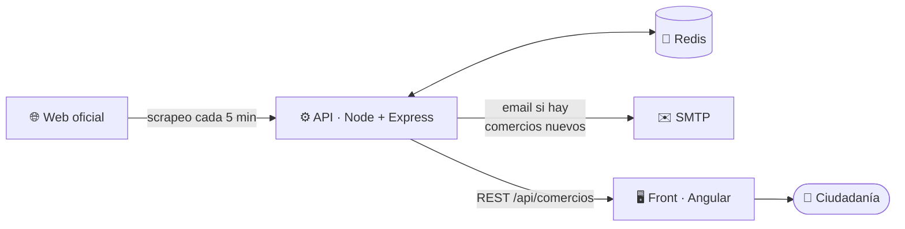

<div align="center">


**Desarrollador fullstack · Castellón de la Plana, España 🇪🇸**

[](mailto:themaxter99@gmail.com)
[](https://github.com/ElMaxter99)

[Perfil](#-perfil) · [Skills](#-skills) · [Proyectos](#-proyectos) · [Otros repos](#-más-código) · [Estadísticas](#-actividad)

</div>

---

## 👤 Perfil

Desarrollador **fullstack** con foco en producto: construyo aplicaciones completas, de la interfaz en Angular al backend en Node.js, y me encargo también de empaquetarlas, desplegarlas y automatizarlas.

| | |
| --- | --- |
| 🧩 **Qué hago** | Frontends en Angular, APIs REST con Node/Express, scraping, mapas, servicios con Docker. |
| ⚙️ **Cómo trabajo** | CI/CD con GitHub Actions, tests, documentación cuidada, i18n y accesibilidad desde el principio. |
| 🌱 **Aprendiendo** | Terraform, contenedores orquestados, observabilidad. |

> 💡 Casi todo lo de la sección de proyectos tiene **demo pública** que puedes abrir y probar, y enlaces al código cuando el repositorio es público.

---

## 🛠️ Skills

<div align="center">

| Área | Tecnologías |
| --- | --- |
| **Frontend** |     |
| **Backend** |    |
| **Datos & mensajería** |     |
| **DevOps & Cloud** |      |
| **Testing** |   |

</div>

---

## 🚀 Proyectos

### ⛽ GasolinaRadar
**Precios de combustible y puntos de carga EV cerca de ti, en un mapa.** Comparas gasolineras por precio, filtras por combustible, conectores o servicios, y consultas estadísticas y viajes. Pensada para escritorio y móvil.

[](https://app.gasolinaradar.es/)

<table>
  <tr>
    <td width="68%"></td>
    <td width="32%"></td>
  </tr>
</table>

- 🗺️ Mapa con **clústeres** y precio de gasolina 95 / gasóleo sobre cada estación.
- 🔌 Puntos de carga EV con conectores, potencia (kW) y estado (libre / en uso).
- 🎛️ Filtros por combustible, servicios (tienda, lavadero, cafetería) y "cerca de mí".
- 📊 Ranking de rentabilidad, estadísticas y viajes.

`Angular` `Node.js` `Express` `MongoDB` `Redis` `RabbitMQ` `Docker` `Leaflet`

> 🔒 El código de este proyecto es privado; la demo es pública.

---

### 🏪 Castellón Comercio · Abonem Castelló
**Buscador y mapa de los comercios adheridos a los bonos de Castelló de la Plana**, con histórico de altas y bajas. La web oficial solo ofrecía un listado paginado sin buscador, sin mapa y sin histórico.

[](https://bono-castellon.alvaromaxter.es/)
[](https://github.com/ElMaxter99/castellon-comercio-notificator-front)
[](https://github.com/ElMaxter99/castellon-comercio-notificator-api)

<table>
  <tr>
    <td width="60%"></td>
    <td width="40%"></td>
  </tr>
</table>

- 🔎 Buscador tolerante a acentos, lista por sector o **mapa con clústeres**.
- ⭐ Favoritos, filtros compartibles por URL y avisos de **altas y bajas**.
- 🌍 Castellano y valencià, responsive, accesible (ARIA, teclado, `prefers-reduced-motion`).
- 🤖 El API vigila la web oficial cada 5 minutos y avisa por email cuando hay comercios nuevos.

<details>
<summary><b>🧭 Arquitectura</b></summary>



Dos ediciones en una sola web: **2025** (demo con datos de ejemplo) y **2026** (renovada). Ver [`docs/EDITIONS.md`](https://github.com/ElMaxter99/castellon-comercio-notificator-front/blob/develop/docs/EDITIONS.md).
</details>

`Angular 20` `TypeScript` `Leaflet` `Node.js` `Express` `Redis` `MongoDB` `GitHub Actions` `Vercel`

---

### 📓 PDF Annotator
**Marca cualquier PDF, obtén las coordenadas exactas en JSON y exporta el documento anotado.** Todo ocurre en el navegador: ningún archivo se sube a un servidor.

[](https://pdf-annotator-rho.vercel.app/)
[](https://github.com/ElMaxter99/pdf-annotator)
[](https://github.com/ElMaxter99/pdf-annotator/blob/develop/CHANGELOG.md)

<table>
  <tr>
    <td width="60%"></td>
    <td width="40%"></td>
  </tr>
</table>

- 🎯 Colocas textos, checks, radios y números con formato; ajustas fuente, color y opacidad.
- 📐 Rejilla, reglas, guías e imán para posicionar con precisión.
- 🧾 JSON en vivo (texto y árbol sincronizados), plantillas reutilizables y exportación a `coords.json` o `annotated.pdf`.
- 🌍 7 idiomas, tema claro/oscuro, atajos de teclado y Docker + NGINX con cabeceras de seguridad.

<details>
<summary><b>🧾 Ejemplo de salida JSON</b></summary>

```json
{
  "pages": [
    {
      "num": 1,
      "fields": [
        { "x": 120.5, "y": 450.25, "mapField": "Firma", "fontSize": 14, "type": "text" }
      ]
    }
  ]
}
```
Coordenadas en puntos PDF, con origen en la esquina inferior izquierda: listas para que un backend rellene facturas, contratos o formularios.
</details>

`Angular 20` `Signals` `TypeScript` `pdf.js` `pdf-lib` `Docker` `NGINX`

---

### 💻 Server Space Monitor
**Alertas por email sobre el espacio en disco de tu servidor.** Un contenedor Docker con acceso de solo lectura al disco del host que avisa cuando se supera un umbral.

[](https://github.com/ElMaxter99/server-space-monitor)

<table>
  <tr>
    <td width="50%"></td>
    <td width="50%"></td>
  </tr>
</table>

- ⏱️ Intervalo configurable y modo "siempre" o "solo si supera el umbral".
- 🕗 Franja horaria permitida para enviar correos.
- 📬 SMTP estándar (Gmail, Outlook…).

<details>
<summary><b>🔍 Cómo funciona</b> · <a href="https://github.com/ElMaxter99/server-space-monitor/blob/master/jobs/scheduler.js"><code>jobs/scheduler.js</code></a></summary>

Un job con `node-cron` consulta el uso del disco y decide si enviar el aviso:

```js
cron.schedule(cronExpr, async () => {
  const status = await diskService.getDiskUsage('/');
  const mode = process.env.CHECK_MODE || 'threshold';
  const threshold = parseFloat(process.env.THRESHOLD_PERCENT || 80);

  if (mode === 'always' || parseFloat(status.percentUsed) >= threshold) {
    await emailService.sendAlertEmail('Alerta: Espacio en disco', message);
  }
});
```
</details>

`Node.js` `Express` `node-cron` `Nodemailer` `Docker`

---

## 📦 Más código

Otros repositorios públicos:

| Repo | |
| --- | --- |
| [`pugIDE`](https://github.com/ElMaxter99/pugIDE) · [`ies-effort-calculator`](https://github.com/ElMaxter99/ies-effort-calculator) · [`subasta-salvaje-public`](https://github.com/ElMaxter99/subasta-salvaje-public) | Herramientas y apps web |
| [`bank-statement-parser`](https://github.com/ElMaxter99/bank-statement-parser) · [`bank-importer-santander`](https://github.com/ElMaxter99/bank-importer-santander) · [`csv-rule-validator`](https://github.com/ElMaxter99/csv-rule-validator) | Parseo y validación de datos |
| [`gym-app-gateway`](https://github.com/ElMaxter99/gym-app-gateway) · [`gym-app-auth-service`](https://github.com/ElMaxter99/gym-app-auth-service) | Microservicios (gateway y autenticación) |
| [`mass-font-downloader`](https://github.com/ElMaxter99/mass-font-downloader) · [`nfc-inventory-web`](https://github.com/ElMaxter99/nfc-inventory-web) · [`mongo-example`](https://github.com/ElMaxter99/mongo-example) | Utilidades y ejemplos |

---

## 📊 Actividad

<div align="center">

[](https://github.com/ElMaxter99)
[](https://github.com/ElMaxter99)

[](https://github.com/ElMaxter99)


</div>

---

<div align="center">

### 📫 ¿Hablamos?
Si te interesa mi trabajo o quieres colaborar, escríbeme.

[](mailto:themaxter99@gmail.com)

</div>
