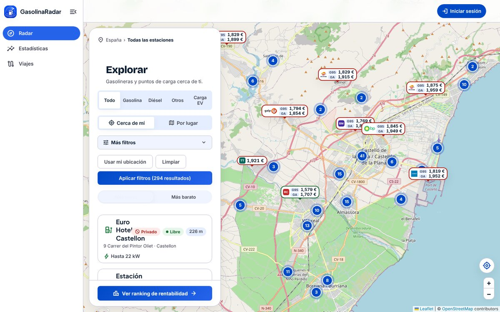
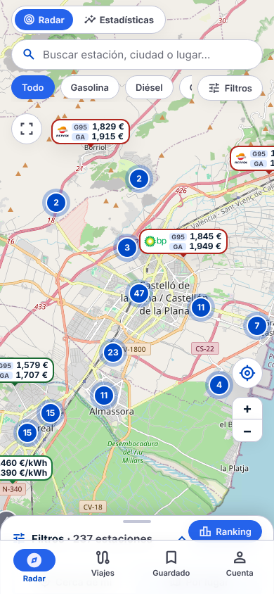
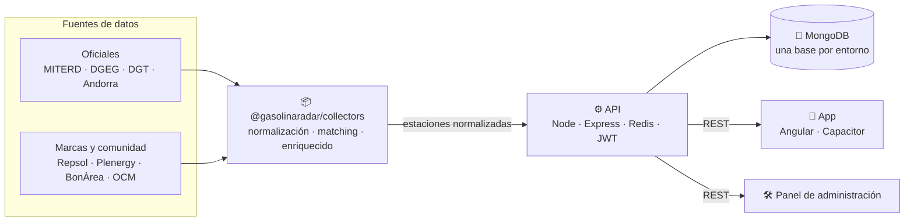
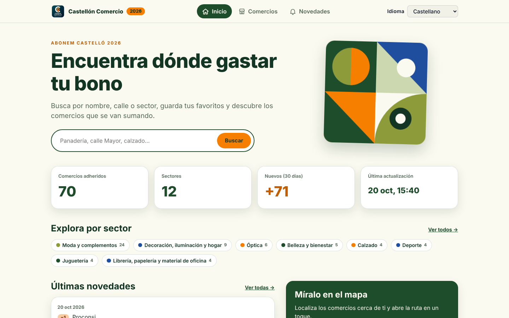
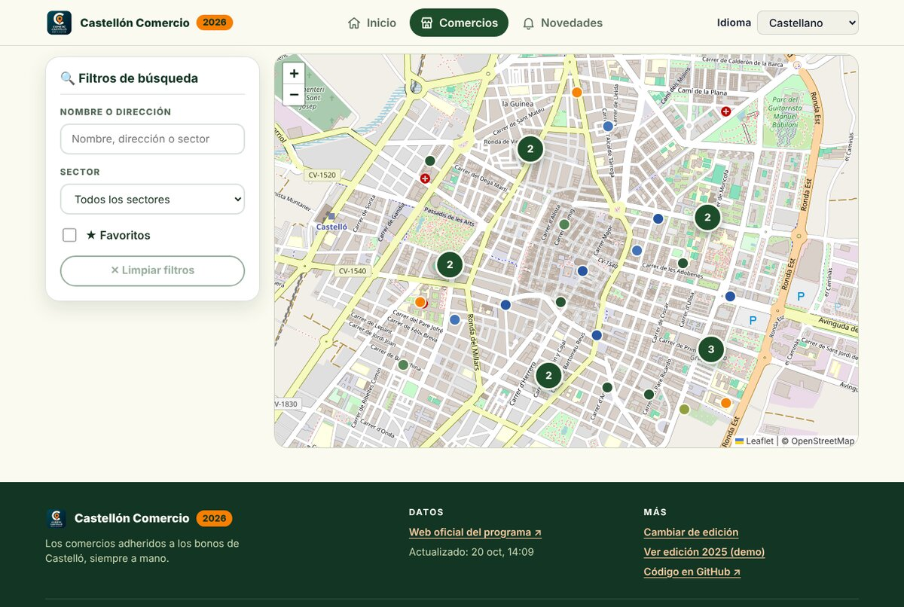
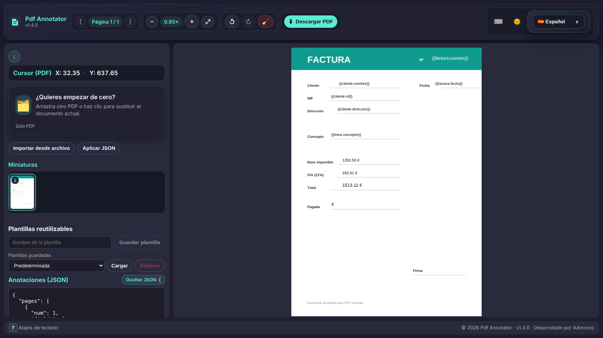
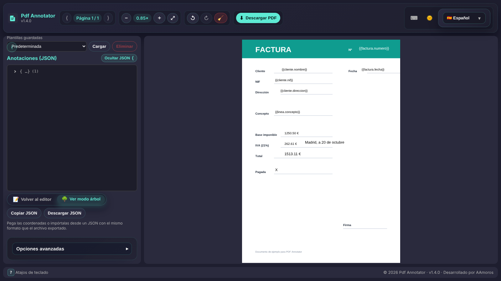
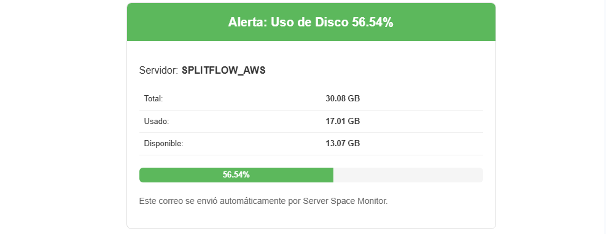
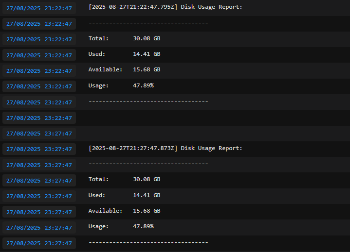

<div align="center">


**Desarrollador fullstack · Castellón de la Plana, España 🇪🇸**

[](mailto:themaxter99@gmail.com)
[](https://github.com/ElMaxter99)

[Perfil](#-perfil) · [Skills](#-skills) · [Proyectos](#-proyectos) · [IA](#-desarrollo-con-ia) · [Otros repos](#-más-código) · [Estadísticas](#-actividad)

</div>

---

## 👤 Perfil

Desarrollador **fullstack** con foco en producto: construyo aplicaciones completas, de la interfaz en Angular al backend en Node.js, y me encargo también de empaquetarlas, desplegarlas y automatizarlas.

| | |
| --- | --- |
| 🧩 **Qué hago** | Frontends en Angular, APIs REST con Node/Express, scraping, mapas, servicios con Docker. |
| ⚙️ **Cómo trabajo** | CI/CD con GitHub Actions, tests, documentación cuidada, i18n y accesibilidad desde el principio. |
| 🌱 **Aprendiendo** | Terraform, contenedores orquestados, observabilidad. |

> 💡 Casi todo lo de la sección de proyectos tiene **demo pública** que puedes abrir y probar, y enlaces al código cuando el repositorio es público.

---

## 🛠️ Skills

<div align="center">

| Área | Tecnologías |
| --- | --- |
| **Frontend** |     |
| **Backend** |    |
| **Datos & mensajería** |     |
| **DevOps & Cloud** |      |
| **Testing** |   |

</div>

---

## 🚀 Proyectos

### ⛽ GasolinaRadar
**Una plataforma que integra fuentes de datos de combustible y carga eléctrica —públicas y no públicas— en un único modelo normalizado.** Nació con una idea ambiciosa: abarcar todo el ciclo de un producto real —ingesta de datos, librerías reutilizables, backend, apps, despliegue y escalabilidad— y no quedarse en "una app con un mapa".

[](https://app.gasolinaradar.es/)
[](https://github.com/gasolinaradar)
[](https://github.com/gasolinaradar/collectors)

<table>
  <tr>
    <td width="68%"></td>
    <td width="32%"></td>
  </tr>
</table>

**Qué ve el usuario**
- 🗺️ Mapa con **clústeres** y precio de gasolina 95 / gasóleo sobre cada estación.
- 🔌 Puntos de carga EV con conectores, potencia (kW) y estado (libre / en uso).
- 🎛️ Filtros por combustible, servicios (tienda, lavadero, cafetería) y "cerca de mí".
- 📊 Ranking de rentabilidad, estadísticas y viajes. Escritorio y móvil.

**Qué hay detrás: una organización propia de librerías**

Cada fuente de datos tiene su **propio paquete npm** (MIT) en la organización [`@gasolinaradar`](https://github.com/gasolinaradar), con un contrato común: todos devuelven estaciones normalizadas con la misma forma. Un paquete agregador las reexporta, de modo que el backend depende de **una sola librería** en vez de una por fuente.

| Fuente | Qué aporta | Librería |
| --- | --- | --- |
| 🇪🇸 MITERD | Dataset oficial de precios de carburantes de España | [`miterd-collector`](https://github.com/gasolinaradar/miterd-collector) |
| 🇵🇹 DGEG | Dataset oficial de Portugal (con enriquecido por detalle) | [`dgeg-collector`](https://github.com/gasolinaradar/dgeg-collector) |
| 🇦🇩 Govern d'Andorra | Servicio oficial de precios (ArcGIS) | [`andorra-collector`](https://github.com/gasolinaradar/andorra-collector) |
| 🔌 DGT | Puntos de recarga EV oficiales (XML DATE X2 leído en streaming) | [`dgtEv-collector`](https://github.com/gasolinaradar/dgtEv-collector) |
| 🔌 OpenChargeMap | Puntos de carga EV en España (API v3, con reintentos y backoff) | [`ocm-collector`](https://github.com/gasolinaradar/ocm-collector) |
| ⛽ Repsol | Buscador de estaciones (no es un dataset público) | [`repsol-collector`](https://github.com/gasolinaradar/repsol-collector) |
| ⛽ Plenergy | Listado público y scraping de la ficha cuando faltan precios | [`plenergy-collector`](https://github.com/gasolinaradar/plenergy-collector) |
| ⛽ BonÀrea | Localizador de estaciones con precios, servicios y horarios | [`bonarea-collector`](https://github.com/gasolinaradar/bonarea-collector) |
| 🏍️ Catálogo de motos | Fichas curadas de fabricante (depósito, consumo) para dar de alta vehículos | [`vehicle-catalog`](https://github.com/gasolinaradar/vehicle-catalog) |

El aspecto más interesante: **cruzar fuentes**. Una estación del dataset oficial (completo pero con datos básicos) se compara con la misma estación en la web de la marca (con horarios y servicios) usando proximidad geográfica y similitud de nombre y dirección, con una confianza de 0 a 100. Después se **rellenan los huecos sin pisar nunca un dato que ya existe**.

<details>
<summary><b>🧪 Ejemplo de código</b> · <a href="https://github.com/gasolinaradar/collectors"><code>@gasolinaradar/collectors</code></a></summary>

```js
const { miterd, plenergy, matching } = require('@gasolinaradar/collectors');

const oficiales = await miterd.createMiterdCollector({ logger }).fetch({ reportProgress });
const marca = await plenergy.createPlenergyCollector({ logger }).fetch({ reportProgress });

// Cruza ambas fuentes y rellena los campos vacíos de la fuente primaria
const enriquecidas = matching.enrichStations([...oficiales, ...marca], {
  primarySource: 'miterd',
});
// cada entrada indica qué collectors han contribuido (`sources`)
```

Contrato común de estación, igual para todas las fuentes:

```js
{
  source, country, sourceStationId,
  name, address, municipality, province, postalCode,
  schedule, services,
  location: { type: 'Point', coordinates: [lon, lat] },
  prices, lastUpdated
}
```
</details>

<details>
<summary><b>🧭 Arquitectura</b></summary>



Principios del diseño:
- **El API es el centro:** todo entra y sale por él; ningún collector escribe en la base de datos.
- **Collectors finos:** cada uno conoce una sola fuente (acceso y parseo). La persistencia y las reglas de negocio no son suyas.
- **Contratos explícitos:** un cambio en el formato de los datos obliga a tocar collector, agregador y API a la vez.
- **Base de datos desacoplada**, con una base lógica por entorno (test, producción y local).
- **Documentación y ADRs** para dejar por escrito el porqué de cada decisión.
</details>

`Angular` `Capacitor` `Node.js` `Express` `MongoDB` `Redis` `RabbitMQ` `npm` `Docker` `Leaflet`

> 🔒 La API y las apps son privadas; las librerías de ingesta son públicas y publicadas en npm.

---

### 🏪 Castellón Comercio · Abonem Castelló
**Buscador y mapa de los comercios adheridos a los bonos de Castelló de la Plana**, con histórico de altas y bajas. La web oficial solo ofrecía un listado paginado sin buscador, sin mapa y sin histórico.

[](https://bono-castellon.alvaromaxter.es/)
[](https://github.com/ElMaxter99/castellon-comercio-notificator-front)
[](https://github.com/ElMaxter99/castellon-comercio-notificator-api)

<table>
  <tr>
    <td width="60%"></td>
    <td width="40%"></td>
  </tr>
</table>

- 🔎 Buscador tolerante a acentos, lista por sector o **mapa con clústeres**.
- ⭐ Favoritos, filtros compartibles por URL y avisos de **altas y bajas**.
- 🌍 Castellano y valencià, responsive, accesible (ARIA, teclado, `prefers-reduced-motion`).
- 🤖 El API vigila la web oficial cada 5 minutos y avisa por email cuando hay comercios nuevos.

<details>
<summary><b>🧭 Arquitectura</b></summary>


Dos ediciones en una sola web: **2025** (demo con datos de ejemplo) y **2026** (renovada). Ver [`docs/EDITIONS.md`](https://github.com/ElMaxter99/castellon-comercio-notificator-front/blob/develop/docs/EDITIONS.md).
</details>

`Angular 20` `TypeScript` `Leaflet` `Node.js` `Express` `Redis` `GitHub Actions` `Vercel` `Render`

---

### 🎪 Subasta Salvaje
**Juego de subastas creativas multijugador para noches de juegos.** Una TV muestra la puja, el anfitrión la dirige y los jugadores pujan desde el móvil mientras la imagen base se transforma con lo que ganan. 

> 🎯 **Por qué existe:** es un juego propio para cuando vienen los amigos a casa: ver quién construye la casa más divertida. Y una buena excusa para plantear una **app entera con *vibe coding***, de la idea al despliegue ([cómo lo hice](#-desarrollo-con-ia)).

[](https://subasta-salvaje.vercel.app)
[](https://github.com/ElMaxter99/subasta-salvaje)

<p align="center"></p>

- 📺 Tres vistas: pantalla de TV, panel de anfitrión y móvil para jugadores, con modo espectador.
- 🧱 Reglas de negocio y dinero en funciones SQL con idempotencia; la app valida, autentica y presenta.
- ✅ Tests unitarios y de integración (Vitest) y flujos extremo a extremo (Playwright).

`Next.js` `TypeScript` `Supabase (Postgres)` `Tailwind` `Vitest` `Playwright` `Vercel`

---

### 📓 PDF Annotator
**Marca cualquier PDF, obtén las coordenadas exactas en JSON y exporta el documento anotado.** Todo ocurre en el navegador: ningún archivo se sube a un servidor.

> 🎯 **Por qué existe:** en algunos proyectos privados tenía que maquetar coordenadas a mano para rellenar PDFs con Hummus y Muhammara. Esta herramienta me quita esa faena: haces clic, copias el JSON y listo.

[](https://pdf-annotator-rho.vercel.app/)
[](https://github.com/ElMaxter99/pdf-annotator)
[](https://github.com/ElMaxter99/pdf-annotator/blob/develop/CHANGELOG.md)

<table>
  <tr>
    <td width="60%"></td>
    <td width="40%"></td>
  </tr>
</table>

- 🎯 Colocas textos, checks, radios y números con formato; ajustas fuente, color y opacidad.
- 📐 Rejilla, reglas, guías e imán para posicionar con precisión.
- 🧾 JSON en vivo (texto y árbol sincronizados), plantillas reutilizables y exportación a `coords.json` o `annotated.pdf`.
- 🌍 7 idiomas, tema claro/oscuro, atajos de teclado y Docker + NGINX con cabeceras de seguridad.

<details>
<summary><b>🧾 Ejemplo de salida JSON</b></summary>

```json
{
  "pages": [
    {
      "num": 1,
      "fields": [
        { "x": 120.5, "y": 450.25, "mapField": "Firma", "fontSize": 14, "type": "text" }
      ]
    }
  ]
}
```
Coordenadas en puntos PDF, con origen en la esquina inferior izquierda: listas para que un backend rellene facturas, contratos o formularios.
</details>

`Angular 20` `Signals` `TypeScript` `pdf.js` `pdf-lib` `Docker` `NGINX`

---

### 💻 Server Space Monitor
**Alertas por email sobre el espacio en disco de tu servidor.** Un contenedor Docker con acceso de solo lectura al disco del host que avisa cuando se supera un umbral.

[](https://github.com/ElMaxter99/server-space-monitor)

<table>
  <tr>
    <td width="50%"></td>
    <td width="50%"></td>
  </tr>
</table>

- ⏱️ Intervalo configurable y modo "siempre" o "solo si supera el umbral".
- 🕗 Franja horaria permitida para enviar correos.
- 📬 SMTP estándar (Gmail, Outlook…).

<details>
<summary><b>🔍 Cómo funciona</b> · <a href="https://github.com/ElMaxter99/server-space-monitor/blob/master/jobs/scheduler.js"><code>jobs/scheduler.js</code></a></summary>

Un job con `node-cron` consulta el uso del disco y decide si enviar el aviso:

```js
cron.schedule(cronExpr, async () => {
  const status = await diskService.getDiskUsage('/');
  const mode = process.env.CHECK_MODE || 'threshold';
  const threshold = parseFloat(process.env.THRESHOLD_PERCENT || 80);

  if (mode === 'always' || parseFloat(status.percentUsed) >= threshold) {
    await emailService.sendAlertEmail('Alerta: Espacio en disco', message);
  }
});
```
</details>

`Node.js` `Express` `node-cron` `Nodemailer` `Docker`

---

## 🤖 Desarrollo con IA
Uso la IA (principalmente **Claude Code**) como herramienta de diseño y desarrollo de extremo a extremo, siempre dirigiendo yo el producto: defino qué se construye y por qué, reviso lo que se genera, pruebo el resultado y decido qué se despliega.

**Caso de estudio: [Subasta Salvaje](https://github.com/ElMaxter99/subasta-salvaje)** — juego web de subastas creativas multijugador ([demo](https://subasta-salvaje.vercel.app)).
- 🎨 **Diseño de producto y UX con IA:** pantalla de TV, panel de anfitrión y vista de móvil para jugadores, modo espectador, accesibilidad móvil, identidad de marca y mascota, e imágenes para compartir (podio).
- 🧱 **Arquitectura revisada y documentada:** reglas de negocio y dinero en funciones SQL con idempotencia, la app solo valida, autentica y presenta; migraciones versionadas con permisos separados.
- ✅ **Calidad con pruebas automáticas:** cientos de tests unitarios y de integración (Vitest) y flujos de extremo a extremo (Playwright), además de auditoría de seguridad, prueba de carga y revisión de accesibilidad.
- 🧑‍🤝‍🧑 **Trabajo con varios agentes en paralelo:** reparto de tareas por áreas en ramas separadas, integración y verificación del conjunto.
- 📚 **Documentación viva:** guía de arquitectura, decisiones, reglas de juego, privacidad y créditos, mantenida junto al código.
- 🔒 **Uso responsable de la IA:** límites de coste (solo proveedores gratuitos), sin secretos en el repositorio y honestidad sobre lo no probado en producción.

**Otro ejemplo: [Castellón Comercio](https://bono-castellon.alvaromaxter.es/)** ([front](https://github.com/ElMaxter99/castellon-comercio-notificator-front) · [API](https://github.com/ElMaxter99/castellon-comercio-notificator-api)) — la evolución 2026 del proyecto, rediseñada con asistencia de IA (Claude Code): nuevas vistas y mapa con clústeres, scraper adaptado a la web oficial, hosting gratuito, documentación completa (incluida una guía para la propia IA) y capturas del README con datos ficticios.

**Y también: [PDF Annotator](https://github.com/ElMaxter99/pdf-annotator)** — auditoría y refactor asistidos con Claude Code: corrección de una vulnerabilidad de ejecución de código en el editor JSON (parser seguro con tests), cabeceras de seguridad en NGINX, rediseño responsive del espacio de trabajo, atajos de teclado, documentación completa (README con capturas, guía de arquitectura y `AGENTS.md`/`CLAUDE.md` para agentes) y revisión por pull request.

> El código lo genera la IA bajo mi dirección y revisión; la responsabilidad del producto, las pruebas y los despliegues es mía.

---

## 📦 Más código

Otros repositorios públicos:

| Repo | |
| --- | --- |
| [`pugIDE`](https://github.com/ElMaxter99/pugIDE) · [`ies-effort-calculator`](https://github.com/ElMaxter99/ies-effort-calculator) | Herramientas y apps web |
| [`bank-statement-parser`](https://github.com/ElMaxter99/bank-statement-parser) · [`bank-importer-santander`](https://github.com/ElMaxter99/bank-importer-santander) · [`csv-rule-validator`](https://github.com/ElMaxter99/csv-rule-validator) | Parseo y validación de datos |
| [`gym-app-gateway`](https://github.com/ElMaxter99/gym-app-gateway) · [`gym-app-auth-service`](https://github.com/ElMaxter99/gym-app-auth-service) | Microservicios (gateway y autenticación) |
| [`mass-font-downloader`](https://github.com/ElMaxter99/mass-font-downloader) · [`nfc-inventory-web`](https://github.com/ElMaxter99/nfc-inventory-web) · [`mongo-example`](https://github.com/ElMaxter99/mongo-example) | Utilidades y ejemplos |

---

## 📊 Actividad

<div align="center">

[](https://github.com/ElMaxter99)
[](https://github.com/ElMaxter99)

[](https://github.com/ElMaxter99)


</div>

---

<div align="center">

### 📫 ¿Hablamos?
Si te interesa mi trabajo o quieres colaborar, escríbeme.

[](mailto:themaxter99@gmail.com)

</div>
